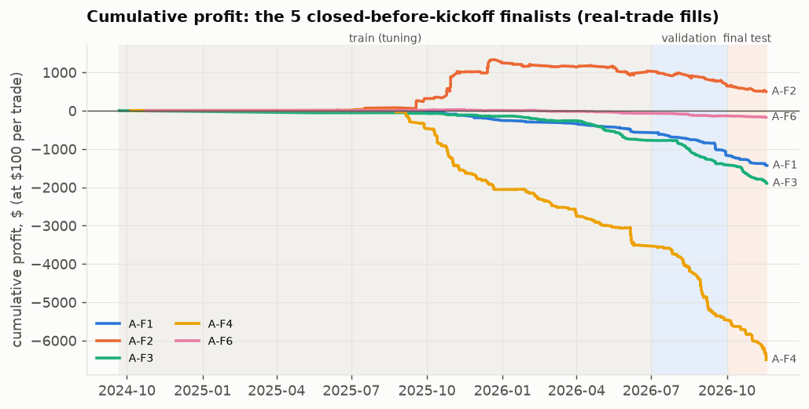
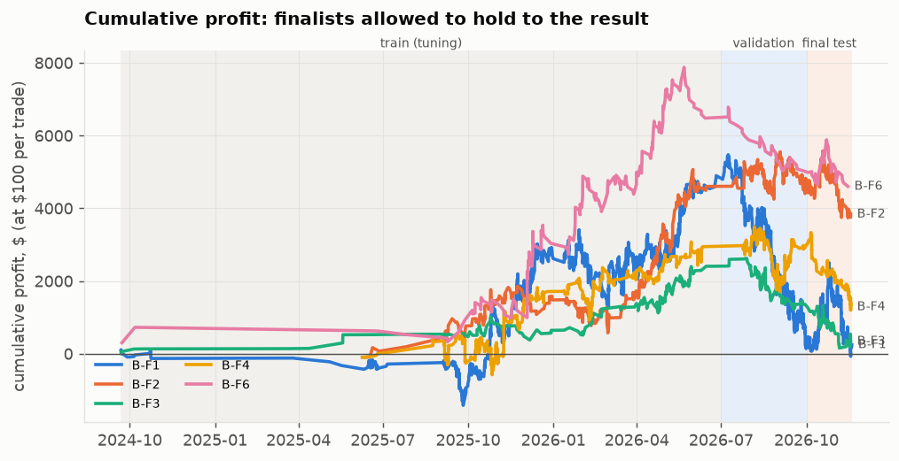
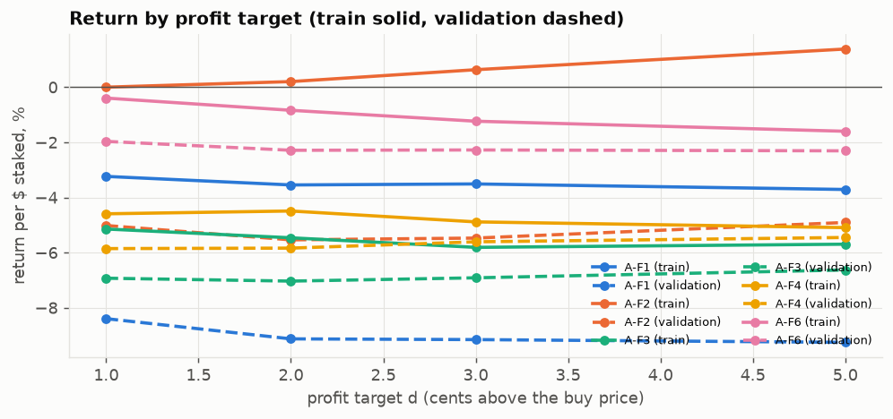
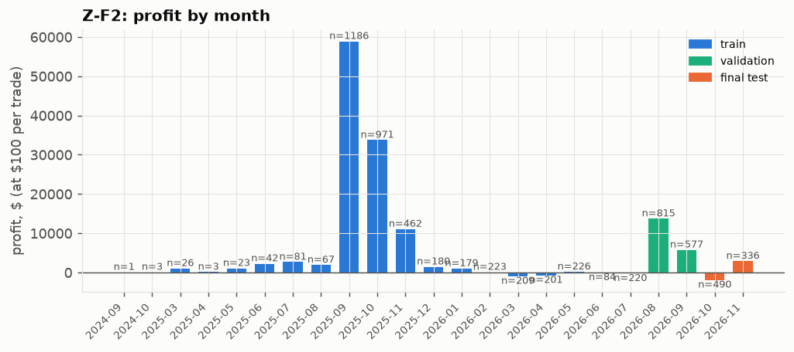
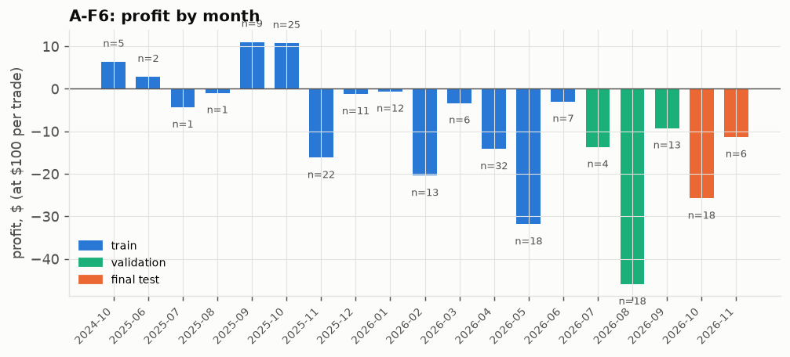
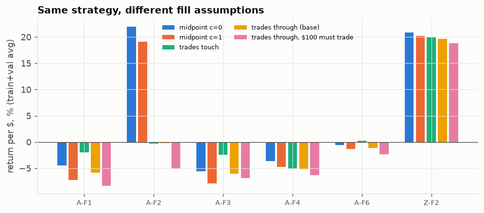

# Can we buy cheap and sell a little higher before kickoff?

*Backtest of buy → limit-sell strategies on Polymarket soccer 1X2 markets, using Winner odds as a signal. 16,763 games, Sep 2025 – Nov 2026. Written 2026-11-20. Research only; no orders were placed.*

## 1. Verdict

**No. We found no buy-then-limit-sell strategy that makes money after realistic costs, and none that is close to risk-free.** We tested 5 families of ideas on 16,763 matched games (September 2025 to November 2026), checked fills against 5.2 million real Polymarket trades, and tried 141,732 rule combinations on the tuning and validation periods. Every finalist that closes its trade before kickoff lost money on validation and again on the untouched final test (October–November 2026): the best of them lost -2.0% per $ on validation and -1.5% on test. The rules that looked very profitable on midpoint prices (up to +27% per $) are an illusion. They buy at prices that only exist as the midpoint of an empty order book, where real buyers paid 4–21 cents more. The pattern is always the same: the +1c to +5c target fills only 20–60% of the time, and the trades that don't fill lose more than the filled ones make. A limit sell above your buy price changes the *shape* of the result (many small wins, fewer bigger losses). It does not create an edge. True arbitrage (buying all three outcomes for under $1) does not exist after fees in the live books we checked; in the history it appears only for a dollar or two at a time.

## 2. Recommended strategy

**None. Do not trade any of these with real money.** No strategy passed validation (validation return > 0 with its 95% confidence interval above 0) using realistic fills, so there is nothing to recommend. The table below gives the exact rules of every finalist, so the claim can be checked.

**What “least bad” looks like:** A-F6, “No signal, fixed time (control)”. Rules: 24 h before kickoff; limit buy at the bid, 4 h; sell limit +1c; if unfilled: sell at market 5 min before kickoff; price 15-85c, series 10k-250k, coherent book, outcome draw No. Validation: -2.0% per $ (35 trades); final test: -1.5% (24 trades). The sell limit filled before kickoff in 37% (validation) and 46% (test) of trades. Unfilled trades were sold at market 5 minutes before kickoff, for an average of -2.9c per share. It is the least bad only because it almost never trades (its buy order filled about 1% of the time).

**If you still want to experiment:** run it as paper trading only, with maker (limit) orders. Change nothing about the rules, and evaluate on kickoffs after 2026-11-20. The live models' CLV of −4% to −6.6% points the same way as this study: prices you can actually buy at tend to move against you.

## 3. All strategies compared

Each finalist is the best rule set of its family on the **train** period (kickoff before 2026-07-01), ranked by a cautious score (average return minus 2 standard errors, games resampled). It was then checked on **validation** (Jul–Sep 2026) and evaluated **once** on the **final test** (kickoff from 2026-10-01). Track A (“A-”) must close before kickoff, as the owner asked. Track B (“B-”) may hold unfilled shares to the result. Z-F2 is the best rule set when we let the model buy at midpoint-based prices in empty books. It is shown only to expose that mirage. Returns are per $ staked at the entry price, after the taker fee where we pay it. Fills are checked against real trades (a resting order fills only if a real trade printed strictly through our price). “Capital” is the peak number of open positions × $100.

| Strategy | Idea | Exact rules (chosen on train) | Train return per $ | Validation return per $ [95% CI] | Final test return per $ [95% CI] | Buy order filled (val) | Sell limit filled before kickoff (val / test) | Held to result (test) | Win rate (test) | Avg / median profit per share (test) | Worst trade per share (test) | Worst day at $100/trade (test) | Profit per month at $100/trade (test) | Capital needed at $100/trade (test peak) |
|---|---|---|---|---|---|---|---|---|---|---|---|---|---|---|
| A-F1 | Winner moved first | signal ≥ 2 pts; limit buy at the bid, 4 h; sell limit +1c; if unfilled: sell at market after 3 h; >12h, price 15-85c, coherent book | -3.2% (n=173) | -8.4% [-11%, -6%] n=72 | -6.6% [-9%, -5%] n=40 | 5% | 50% / 52% | 0% | 15% | -3.0c / -2.7c | -9c | $-33 | $-171 | $400 |
| A-F2 | Polymarket below Winner fair value | signal ≥ 8 pts; limit buy at the bid, 4 h; sell limit Winner's fair price; if unfilled: sell at market after 12 h; >12h, price 25-75c | +5.5% (n=190) | -5.9% [-9%, -2%] n=66 | -5.3% [-10%, +0%] n=28 | 3% | 23% / 18% | 0% | 25% | -1.3c / -3.1c | -9c | $-30 | $-102 | $600 |
| A-F3 | Fade a sharp Polymarket jump | signal ≥ 5 pts; limit buy at the bid, 1 h; sell limit +1c; if unfilled: sell at market after 12 h; <=12h, price 25-75c, coherent book | -5.1% (n=150) | -6.9% [-8%, -6%] n=92 | -6.5% [-8%, -5%] n=74 | 22% | 23% / 22% | 0% | 23% | -2.8c / -2.9c | -10c | $-48 | $-313 | $300 |
| A-F4 | Stale outcome (3 prices don't add to 100%) | signal ≥ 3 pts; buy at the ask (taker); sell limit +2c; if unfilled: sell at market 5 min before kickoff; >12h, price 15-85c, series 10k-250k, coherent book | -4.5% (n=780) | -5.8% [-7%, -5%] n=336 | -5.0% [-7%, -4%] n=205 | 100% | 46% / 50% | 0% | 55% | -2.8c / +0.8c | -43c | $-125 | $-655 | $3,700 |
| A-F6 | No signal, fixed time (control) | 24 h before kickoff; limit buy at the bid, 4 h; sell limit +1c; if unfilled: sell at market 5 min before kickoff; price 15-85c, series 10k-250k, coherent book, outcome draw No | -0.4% (n=164) | -2.0% [-3%, -1%] n=35 | -1.5% [-3%, -0%] n=24 | 1% | 37% / 46% | 0% | 46% | -1.1c / -2.0c | -6c | $-11 | $-25 | $300 |
| B-F1 | Winner moved first | signal ≥ 3 pts; buy at the ask, only if someone really bought there; sell limit +5c; if unfilled: hold to the result; price 15-85c | +4.3% (n=1147) | -8.3% [-17%, +0%] n=564 | +0.0% [-9%, +9%] n=388 | 36% | 7% / 7% | 93% | 61% | +1.5c / +17.5c | -84c | $-673 | $10 | $1,100 |
| B-F2 | Polymarket below Winner fair value | signal ≥ 5 pts; limit buy at the bid, 1 h; sell limit +1c; if unfilled: hold to the result; <=12h, price 25-75c, series 10k-250k, non-top | +11.4% (n=403) | +1.1% [-14%, +16%] n=211 | -7.6% [-26%, +13%] n=130 | 11% | 32% / 22% | 78% | 51% | -2.8c / +1.0c | -73c | $-321 | $-637 | $400 |
| B-F3 | Fade a sharp Polymarket jump | signal ≥ 5 pts; limit buy at the bid, 1 h; sell limit +2c; if unfilled: hold to the result; price 25-75c, series 10k-250k, coherent book | +15.3% (n=157) | -11.9% [-32%, +10%] n=88 | -16.7% [-45%, +11%] n=61 | 13% | 28% / 18% | 82% | 48% | -7.7c / -25.0c | -62c | $-300 | $-674 | $300 |
| B-F4 | Stale outcome (3 prices don't add to 100%) | signal ≥ 3 pts; buy at the ask (taker); sell limit +5c; if unfilled: hold to the result; >12h, price 15-85c, series 10k-250k, non-top, coherent book | +3.9% (n=749) | +0.1% [-8%, +8%] n=301 | -8.3% [-16%, +0%] n=205 | 100% | 25% / 35% | 65% | 74% | -4.3c / +4.1c | -84c | $-330 | $-1,073 | $4,000 |
| B-F6 | No signal, fixed time (control) | 24 h before kickoff; limit buy at mid, 1 h; sell limit +5c; if unfilled: hold to the result; >12h, price 15-85c, series 10k-250k, coherent book, outcome draw Yes | +37.0% (n=175) | -42.3% [-80%, +7%] n=33 | -12.4% [-62%, +46%] n=39 | 1% | 3% / 3% | 97% | 23% | -3.8c / -24.0c | -34c | $-400 | $-349 | $400 |
| Z-F2 | Polymarket below Winner fair value | signal ≥ 8 pts; buy at the ask (taker); sell limit Winner's fair price; if unfilled: sell at market 5 min before kickoff; >12h, price 25-75c, series 10k-250k | +27.4% (n=4167) | +11.9% [+9%, +15%] n=1612 | +1.2% [-2%, +4%] n=826 | 100% | 49% / 29% | 0% | 48% | +2.5c / -0.2c | -22c | $-289 | $594 | $17,500 |

Of the 5 closed-before-kickoff finalists, 0 made money on the test period. Of the 5 hold-to-result finalists, 1 did, and those are coin-flips with confidence intervals of about ±10–50%. In total, 11 rule sets were evaluated on test, once each.

## 4. Charts

*Cumulative profit at $100 per trade, by kickoff date. Grey = tuning, blue = validation, orange = final test. All five drift down out of sample.*

*Z-F2, the ‘mirage’: buying Polymarket ≥8 pts below Winner at ‘midpoint + half-spread’. Most of the paper profit came in a few months of 2025, when many books were empty, and it nearly stops on the final test. Real buyers could not get these prices (section 6).*

*Finalists allowed to hold unfilled shares to the result. Their curves are mostly settlement luck, so they swing a lot.*

*How often orders fill, over all F1–F4 signals in train and validation. ‘Through’ means a real trade printed strictly better than our limit; ‘touch’ allows a trade at exactly our price, which is optimistic. Midpoint rules are what you get without trade data.*

*Return by profit target d for the closed-before-kickoff finalists (train solid, validation dashed). No target makes them profitable out of sample.*

*The midpoint mirage by month: large in the tuning months, shrinking, close to zero in the final test.*

*A-F6 (no-signal control, maker buy, +1c target) by month: small, steady losses.*

*The same finalists under different fill assumptions (train + validation average). Midpoint-based fills are far too kind for the F2 rules. With real trades every rule is negative or near zero.*

## 5. What we tested

- **F1 Winner moved first.** Winner's margin-free probability moved ≥2/3/5 points in 6 h, and Polymarket moved less than half of that, so we follow Winner. This is the existing move_v1 idea.
- **F2 Model / fair-value gap.** Polymarket is ≥3/5/8 points below Winner's margin-free probability (or above it, so we buy No). The sell target can be Winner's fair price. Winner's probability stands in for the live models, whose historical scores we did not rebuild. The live CLV of −4% to −6.6% suggests they would not do better.
- **F3 Overreaction fade.** Polymarket moved ≥5/8/12 points in an hour while Winner moved less than 1 point that way, so we buy the other side.
- **F4 Stale outcome.** The three Yes prices add up to more or less than 100% by ≥3/5/8 points after one outcome moved. We buy (or sell via No) the outcome that hasn't updated.
- **F6 Control / time-to-kickoff.** No signal: every outcome and side at 24 h and 6 h before kickoff, also split by outcome (home/draw/away, Yes/No). It measures pure market-making and any kickoff drift.
- **Structural arbitrage:** buy all three Yes for under $1, or all three No for under $2 (live books, minute midpoints and real trades).
- **Extra slices:** the Israel-morning hours (06–10) and the first 6 hours after a market opens.
- **Grid for each family:** signal threshold × buy style (taker, verified taker, maker at the bid for 1 h or 4 h, maker at the mid) × target (+1, +2, +3, +5c, Winner fair) × if unfilled (sell at kickoff, after 3 h, after 12 h, hold) × filters: hours to kickoff (>12 h / ≤12 h), price (15–85c / 25–75c), series volume ($10k–$250k, from training months only, so no look-ahead), non-top leagues, and a coherent book (the 3 Yes prices sum to 0.98–1.05). Longshots under 15c are always excluded.

## 6. Why it doesn't work (in plain words)

- **Polymarket is usually right first.** When Winner and Polymarket disagree, Polymarket is more often the one already at the new price (see the lead/lag study). Buying Polymarket ‘cheap’ against Winner usually means buying just before Winner catches up to Polymarket, not the other way round.
- **A limit buy fills when you least want it to.** Your resting bid fills when sellers push the price down through it, often because of news. After a ‘through’ fill the price tends to keep going down. Only 4–9% of maker buys at the bid filled at all with real trades, and those were the worse ones.
- **A sell limit above your price is not free money.** With +2c targets the sell filled in about 30–56% of trades before kickoff. The rest are sold at kickoff at a loss, or held to the result. The losses are bigger than the small wins, so the average is negative.
- **Midpoints lie in thin books.** In 3% (F1) to 74% (F4) of signals the three Yes ‘prices’ add up to more than 105%. The book is nearly empty and the midpoint is meaningless. Real buyers in those moments paid 4–21c more than ‘midpoint + half-spread’, and usually nobody traded at all (table below). Every big paper profit we found came from these moments.

| Signal | Sum of the 3 Yes prices | Signals | Someone really bought within 30 min | Real price paid minus our model's ask (median) |
|---|---|---|---|---|
| Winner moved first | <0.98 | 527 | 19% | -0.3c |
| Winner moved first | 0.98-1.05 (coherent) | 14,082 | 45% | -0.2c |
| Winner moved first | 1.05-1.15 | 73 | 8% | +1.1c |
| Winner moved first | >1.15 | 412 | 1% | +3.8c |
| Polymarket below Winner fair value | <0.98 | 10,470 | 5% | +0.0c |
| Polymarket below Winner fair value | 0.98-1.05 (coherent) | 127,735 | 15% | -0.3c |
| Polymarket below Winner fair value | 1.05-1.15 | 3,372 | 4% | +4.4c |
| Polymarket below Winner fair value | >1.15 | 16,011 | 2% | +19.3c |
| Fade a sharp Polymarket jump | <0.98 | 2,967 | 7% | +0.5c |
| Fade a sharp Polymarket jump | 0.98-1.05 (coherent) | 7,155 | 18% | -0.3c |
| Fade a sharp Polymarket jump | 1.05-1.15 | 2,058 | 4% | +4.0c |
| Fade a sharp Polymarket jump | >1.15 | 8,150 | 2% | +15.5c |
| Stale outcome (3 prices don't add to 100%) | <0.98 | 6,263 | 6% | +0.5c |
| Stale outcome (3 prices don't add to 100%) | 0.98-1.05 (coherent) | 1,823 | 7% | +0.3c |
| Stale outcome (3 prices don't add to 100%) | 1.05-1.15 | 5,968 | 2% | +1.0c |
| Stale outcome (3 prices don't add to 100%) | >1.15 | 16,640 | 1% | +2.5c |
| No signal, fixed time (control) | <0.98 | 2,126 | 6% | -0.2c |
| No signal, fixed time (control) | 0.98-1.05 (coherent) | 65,944 | 11% | -0.0c |
| No signal, fixed time (control) | 1.05-1.15 | 306 | 5% | +0.5c |
| No signal, fixed time (control) | >1.15 | 1,074 | 2% | +12.5c |

| Fill rule | Buy order | Buy filled | Then +2c sell filled before kickoff |
|---|---|---|---|
| real trades (through) | limit buy at the bid, 4 h | 9% | 35% |
| real trades (through) | limit buy at the bid, 1 h | 4% | 35% |
| real trades (through) | limit buy at mid, 1 h | 8% | 30% |
| real trades (through) | buy at the ask (taker) | 100% | 40% |
| real trades (through) | buy at the ask, only if someone really bought there | 13% | 25% |
| real trades (touch) | limit buy at the bid, 4 h | 16% | 56% |
| real trades (touch) | limit buy at the bid, 1 h | 8% | 56% |
| real trades (touch) | limit buy at mid, 1 h | 16% | 47% |
| real trades (touch) | buy at the ask (taker) | 100% | 40% |
| real trades (touch) | buy at the ask, only if someone really bought there | 13% | 27% |
| midpoint c=1 | limit buy at the bid, 4 h | 14% | 64% |
| midpoint c=1 | limit buy at the bid, 1 h | 7% | 70% |
| midpoint c=1 | limit buy at mid, 1 h | 12% | 62% |
| midpoint c=1 | buy at the ask (taker) | 100% | 40% |
| midpoint c=0 | limit buy at the bid, 4 h | 22% | 67% |
| midpoint c=0 | limit buy at the bid, 1 h | 12% | 72% |
| midpoint c=0 | limit buy at mid, 1 h | 36% | 64% |
| midpoint c=0 | buy at the ask (taker) | 100% | 47% |

## 7. Fees, spreads and arbitrage facts used

- **Fees (Polymarket docs, read 2026-11-20, and each market's feeSchedule):** sports taker fee = 0.05 × price × (1 − price) per share, which is about 1.25c at 50c. **Makers pay no fee.** Makers get a 15% rebate of the taker fees their fills generate, about 0.2c per share, too small to change any result. From 2026-11-20 23:59 UTC, maker rebates become tiered ($200k+ monthly volume to qualify) and taker fees are unchanged. Liquidity rewards for resting quotes exist per market (e.g. min 50 shares, within 4.5c of mid), but past payouts aren't public, so they are not included.
- **Spreads:** we charge half-spreads of 2c (games under $10k final volume), 1c ($10k–50k), 0.75c ($50k–250k) and 0.5c (above). Live books (2 snapshots, 1,512 event books) give median spreads of 1c in active books and 3c+ in thin ones. Real trade prints show a median effective half-spread of 0.5c, but people trade when spreads are tight, so we kept the more cautious model. Doubling the spread on taker legs makes everything worse (sensitivity table).
- **Arbitrage, live books:** 1,512 event snapshots. The sum of the 3 Yes asks was below $1 in 3 books, but after taker fees in 0 (cheapest cost 1.011). Three No for under $2 after fees: 0 (cheapest 2.006). Median sum of asks: 1.04.
- **Arbitrage, history:** real taker buys of all three outcomes within 10 minutes at a total under $1 after fees happened in 313 of 14,622 events (2%). The smallest leg was typically about $1, so the profit was a few cents per event. Not a business.

## 8. Robustness and extra checks

Sensitivity of the closed-before-kickoff finalists and the mirage to the fill assumption, required size and spread:

| Strategy | Assumption | Train | Validation | Test |
|---|---|---|---|---|
| A-F1 | trades through (base) | -3.2% | -8.4% | -6.6% |
| A-F1 | trades touch | -0.3% | -3.6% | -4.4% |
| A-F1 | trades through, $100 must trade | -4.8% | -11.8% | -8.2% |
| A-F1 | midpoint c=1 | -5.7% | -8.9% | -7.9% |
| A-F1 | midpoint c=0 | -3.8% | -5.2% | -4.9% |
| A-F1 | spread x2 on taker legs | -3.8% | -9.5% | -7.7% |
| A-F2 | trades through (base) | +5.5% | -5.9% | -5.3% |
| A-F2 | trades touch | +2.8% | -3.5% | -5.7% |
| A-F2 | trades through, $100 must trade | +1.3% | -11.3% | -5.2% |
| A-F2 | midpoint c=1 | +24.4% | +13.8% | +13.3% |
| A-F2 | midpoint c=0 | +27.7% | +16.3% | +14.3% |
| A-F2 | spread x2 on taker legs | +3.4% | -8.0% | -7.5% |
| A-F3 | trades through (base) | -5.1% | -6.9% | -6.5% |
| A-F3 | trades touch | -1.9% | -3.0% | -2.8% |
| A-F3 | trades through, $100 must trade | -5.5% | -8.2% | -8.6% |
| A-F3 | midpoint c=1 | -7.7% | -8.1% | -7.0% |
| A-F3 | midpoint c=0 | -5.1% | -6.0% | -5.5% |
| A-F3 | spread x2 on taker legs | -6.5% | -8.4% | -8.1% |
| A-F4 | trades through (base) | -4.5% | -5.8% | -5.0% |
| A-F4 | trades touch | -4.5% | -5.8% | -5.0% |
| A-F4 | trades through, $100 must trade | -5.9% | -6.7% | -5.1% |
| A-F4 | midpoint c=1 | -4.4% | -5.2% | -4.8% |
| A-F4 | midpoint c=0 | -3.3% | -4.1% | -3.9% |
| A-F4 | spread x2 on taker legs | -7.3% | -9.1% | -7.8% |
| A-F6 | trades through (base) | -0.4% | -2.0% | -1.5% |
| A-F6 | trades touch | +0.6% | -0.1% | +0.0% |
| A-F6 | trades through, $100 must trade | -1.4% | -3.2% | -0.1% |
| A-F6 | midpoint c=1 | -1.1% | -1.6% | -0.7% |
| A-F6 | midpoint c=0 | -0.4% | -0.9% | -0.9% |
| A-F6 | spread x2 on taker legs | -0.8% | -2.6% | -2.1% |
| Z-F2 | trades through (base) | +27.4% | +11.9% | +1.2% |
| Z-F2 | trades touch | +27.7% | +12.1% | +1.5% |
| Z-F2 | trades through, $100 must trade | +25.9% | +11.6% | +0.8% |
| Z-F2 | midpoint c=1 | +28.2% | +12.2% | +2.1% |
| Z-F2 | midpoint c=0 | +29.0% | +12.8% | +2.8% |
| Z-F2 | spread x2 on taker legs | +23.2% | +7.6% | -4.3% |

Extra slices (train and validation only, never test): Israel-morning hours and newly opened markets. All are negative.

| Signal | Buy | Sell target | Slice | Train | Validation |
|---|---|---|---|---|---|
| Winner moved first | limit buy at the bid, 4 h | Winner fair | Israel 06-10h | -3.8% | -4.1% |
| Winner moved first | limit buy at the bid, 4 h | Winner fair | market >= 6 h old | -5.1% | -7.9% |
| Winner moved first | limit buy at the bid, 4 h | Winner fair | other hours | -5.2% | -8.4% |
| Winner moved first | limit buy at the bid, 4 h | +2c | Israel 06-10h | -4.0% | -4.5% |
| Winner moved first | limit buy at the bid, 4 h | +2c | market >= 6 h old | -4.9% | -7.8% |
| Winner moved first | limit buy at the bid, 4 h | +2c | other hours | -5.1% | -8.2% |
| Winner moved first | buy at the ask, only if someone really bought there | Winner fair | Israel 06-10h | -5.0% | -5.7% |
| Winner moved first | buy at the ask, only if someone really bought there | Winner fair | market >= 6 h old | -6.7% | -7.2% |
| Winner moved first | buy at the ask, only if someone really bought there | Winner fair | other hours | -6.9% | -7.3% |
| Winner moved first | buy at the ask, only if someone really bought there | +2c | Israel 06-10h | -4.7% | -5.3% |
| Winner moved first | buy at the ask, only if someone really bought there | +2c | market >= 6 h old | -6.9% | -7.2% |
| Winner moved first | buy at the ask, only if someone really bought there | +2c | other hours | -7.1% | -7.4% |
| Polymarket below Winner fair value | limit buy at the bid, 4 h | Winner fair | Israel 06-10h | -4.8% | -8.6% |
| Polymarket below Winner fair value | limit buy at the bid, 4 h | Winner fair | market < 6 h old | +0.5% | -9.8% |
| Polymarket below Winner fair value | limit buy at the bid, 4 h | Winner fair | market >= 6 h old | -5.4% | -8.6% |
| Polymarket below Winner fair value | limit buy at the bid, 4 h | Winner fair | other hours | -5.2% | -8.6% |
| Polymarket below Winner fair value | limit buy at the bid, 4 h | +2c | Israel 06-10h | -4.1% | -8.5% |
| Polymarket below Winner fair value | limit buy at the bid, 4 h | +2c | market < 6 h old | -1.1% | -6.3% |
| Polymarket below Winner fair value | limit buy at the bid, 4 h | +2c | market >= 6 h old | -4.5% | -8.5% |
| Polymarket below Winner fair value | limit buy at the bid, 4 h | +2c | other hours | -4.4% | -8.4% |
| Polymarket below Winner fair value | buy at the ask, only if someone really bought there | Winner fair | Israel 06-10h | -10.0% | -10.9% |
| Polymarket below Winner fair value | buy at the ask, only if someone really bought there | Winner fair | market < 6 h old | -8.9% | -11.7% |
| Polymarket below Winner fair value | buy at the ask, only if someone really bought there | Winner fair | market >= 6 h old | -11.3% | -10.9% |
| Polymarket below Winner fair value | buy at the ask, only if someone really bought there | Winner fair | other hours | -11.5% | -10.9% |
| Polymarket below Winner fair value | buy at the ask, only if someone really bought there | +2c | Israel 06-10h | -8.9% | -9.9% |
| Polymarket below Winner fair value | buy at the ask, only if someone really bought there | +2c | market < 6 h old | -7.1% | -11.0% |
| Polymarket below Winner fair value | buy at the ask, only if someone really bought there | +2c | market >= 6 h old | -10.6% | -10.5% |
| Polymarket below Winner fair value | buy at the ask, only if someone really bought there | +2c | other hours | -10.9% | -10.6% |
| No signal, fixed time (control) | limit buy at the bid, 4 h | +2c | Israel 06-10h | -2.3% | -3.9% |
| No signal, fixed time (control) | limit buy at the bid, 4 h | +2c | market < 6 h old | -11.1% | -22.2% |
| No signal, fixed time (control) | limit buy at the bid, 4 h | +2c | market >= 6 h old | -3.7% | -7.2% |
| No signal, fixed time (control) | limit buy at the bid, 4 h | +2c | other hours | -3.9% | -7.8% |
| No signal, fixed time (control) | buy at the ask, only if someone really bought there | +2c | Israel 06-10h | -8.3% | -7.8% |
| No signal, fixed time (control) | buy at the ask, only if someone really bought there | +2c | market < 6 h old | -9.5% | -12.7% |
| No signal, fixed time (control) | buy at the ask, only if someone really bought there | +2c | market >= 6 h old | -8.0% | -7.8% |
| No signal, fixed time (control) | buy at the ask, only if someone really bought there | +2c | other hours | -8.0% | -7.8% |

Monthly results of the closed-before-kickoff finalists and the mirage:

| Strategy | Month | Period | Trades | Return per $ | Profit at $100/trade |
|---|---|---|---|---|---|
| A-F1 | 2024-10 | train | 3 | -2.2% | $-7 |
| A-F1 | 2025-06 | train | 11 | -2.7% | $-30 |
| A-F1 | 2025-07 | train | 2 | -4.9% | $-10 |
| A-F1 | 2025-09 | train | 20 | +1.0% | $19 |
| A-F1 | 2025-10 | train | 25 | -2.6% | $-64 |
| A-F1 | 2025-11 | train | 27 | -3.5% | $-95 |
| A-F1 | 2025-12 | train | 20 | -3.5% | $-70 |
| A-F1 | 2026-01 | train | 10 | -3.8% | $-38 |
| A-F1 | 2026-02 | train | 7 | -1.4% | $-10 |
| A-F1 | 2026-03 | train | 10 | -3.4% | $-34 |
| A-F1 | 2026-04 | train | 11 | -6.2% | $-68 |
| A-F1 | 2026-05 | train | 13 | -5.4% | $-70 |
| A-F1 | 2026-06 | train | 14 | -6.1% | $-86 |
| A-F1 | 2026-07 | val | 21 | -6.2% | $-131 |
| A-F1 | 2026-08 | val | 23 | -5.3% | $-122 |
| A-F1 | 2026-09 | val | 28 | -12.6% | $-352 |
| A-F1 | 2026-10 | test | 28 | -6.9% | $-192 |
| A-F1 | 2026-11 | test | 12 | -6.1% | $-73 |
| A-F2 | 2025-06 | train | 3 | +1.2% | $4 |
| A-F2 | 2025-07 | train | 5 | +12.6% | $63 |
| A-F2 | 2025-08 | train | 1 | +11.0% | $11 |
| A-F2 | 2025-09 | train | 8 | +30.0% | $240 |
| A-F2 | 2025-10 | train | 44 | +13.1% | $577 |
| A-F2 | 2025-11 | train | 18 | +6.6% | $119 |
| A-F2 | 2025-12 | train | 27 | +8.7% | $235 |
| A-F2 | 2026-01 | train | 9 | -10.4% | $-94 |
| A-F2 | 2026-02 | train | 14 | -0.4% | $-6 |
| A-F2 | 2026-03 | train | 8 | -1.5% | $-12 |
| A-F2 | 2026-04 | train | 14 | +1.0% | $14 |
| A-F2 | 2026-05 | train | 17 | -8.7% | $-147 |
| A-F2 | 2026-06 | train | 22 | +1.4% | $31 |
| A-F2 | 2026-07 | val | 15 | -5.4% | $-81 |
| A-F2 | 2026-08 | val | 26 | -3.1% | $-80 |
| A-F2 | 2026-09 | val | 25 | -9.1% | $-228 |
| A-F2 | 2026-10 | test | 18 | -5.2% | $-93 |
| A-F2 | 2026-11 | test | 10 | -5.5% | $-55 |
| A-F3 | 2024-09 | train | 2 | +0.2% | $0 |
| A-F3 | 2024-10 | train | 1 | +1.8% | $2 |
| A-F3 | 2025-05 | train | 1 | -58.3% | $-58 |
| A-F3 | 2025-09 | train | 6 | -2.5% | $-15 |
| A-F3 | 2025-10 | train | 10 | -3.7% | $-37 |
| A-F3 | 2025-11 | train | 9 | -1.5% | $-13 |
| A-F3 | 2025-12 | train | 9 | -2.2% | $-20 |
| A-F3 | 2026-01 | train | 7 | -4.9% | $-34 |
| A-F3 | 2026-02 | train | 14 | -5.5% | $-77 |
| A-F3 | 2026-03 | train | 6 | -1.0% | $-6 |
| A-F3 | 2026-04 | train | 29 | -5.7% | $-165 |
| A-F3 | 2026-05 | train | 47 | -6.5% | $-304 |
| A-F3 | 2026-06 | train | 9 | -4.8% | $-43 |
| A-F3 | 2026-07 | val | 7 | -1.0% | $-7 |
| A-F3 | 2026-08 | val | 54 | -8.0% | $-430 |
| A-F3 | 2026-09 | val | 31 | -6.5% | $-201 |
| A-F3 | 2026-10 | test | 48 | -6.8% | $-327 |
| A-F3 | 2026-11 | test | 26 | -6.0% | $-157 |
| A-F4 | 2024-10 | train | 1 | +5.4% | $5 |
| A-F4 | 2025-06 | train | 5 | +1.6% | $8 |
| A-F4 | 2025-07 | train | 1 | +1.4% | $1 |
| A-F4 | 2025-08 | train | 6 | -7.8% | $-47 |
| A-F4 | 2025-09 | train | 65 | -6.7% | $-435 |
| A-F4 | 2025-10 | train | 150 | -5.2% | $-786 |
| A-F4 | 2025-11 | train | 161 | -3.2% | $-516 |
| A-F4 | 2025-12 | train | 66 | -4.4% | $-289 |
| A-F4 | 2026-01 | train | 33 | -2.0% | $-67 |
| A-F4 | 2026-02 | train | 75 | -3.8% | $-288 |
| A-F4 | 2026-03 | train | 49 | -7.0% | $-342 |
| A-F4 | 2026-04 | train | 50 | -4.2% | $-210 |
| A-F4 | 2026-05 | train | 36 | -2.7% | $-95 |
| A-F4 | 2026-06 | train | 82 | -5.4% | $-444 |
| A-F4 | 2026-07 | val | 60 | -4.3% | $-257 |
| A-F4 | 2026-08 | val | 188 | -5.4% | $-1,017 |
| A-F4 | 2026-09 | val | 88 | -7.8% | $-688 |
| A-F4 | 2026-10 | test | 111 | -4.7% | $-523 |
| A-F4 | 2026-11 | test | 94 | -5.4% | $-511 |
| A-F6 | 2024-10 | train | 5 | +1.3% | $6 |
| A-F6 | 2025-06 | train | 2 | +1.4% | $3 |
| A-F6 | 2025-07 | train | 1 | -4.3% | $-4 |
| A-F6 | 2025-08 | train | 1 | -1.0% | $-1 |
| A-F6 | 2025-09 | train | 9 | +1.2% | $11 |
| A-F6 | 2025-10 | train | 25 | +0.4% | $11 |
| A-F6 | 2025-11 | train | 22 | -0.7% | $-16 |
| A-F6 | 2025-12 | train | 11 | -0.1% | $-1 |
| A-F6 | 2026-01 | train | 12 | -0.0% | $-1 |
| A-F6 | 2026-02 | train | 13 | -1.6% | $-20 |
| A-F6 | 2026-03 | train | 6 | -0.6% | $-3 |
| A-F6 | 2026-04 | train | 32 | -0.4% | $-14 |
| A-F6 | 2026-05 | train | 18 | -1.8% | $-32 |
| A-F6 | 2026-06 | train | 7 | -0.4% | $-3 |
| A-F6 | 2026-07 | val | 4 | -3.4% | $-14 |
| A-F6 | 2026-08 | val | 18 | -2.6% | $-46 |
| A-F6 | 2026-09 | val | 13 | -0.7% | $-9 |
| A-F6 | 2026-10 | test | 18 | -1.4% | $-26 |
| A-F6 | 2026-11 | test | 6 | -1.9% | $-11 |
| Z-F2 | 2024-09 | train | 1 | +73.2% | $73 |
| Z-F2 | 2024-10 | train | 3 | +36.0% | $108 |
| Z-F2 | 2025-03 | train | 26 | +40.3% | $1,047 |
| Z-F2 | 2025-04 | train | 3 | +44.8% | $135 |
| Z-F2 | 2025-05 | train | 23 | +47.5% | $1,093 |
| Z-F2 | 2025-06 | train | 42 | +54.1% | $2,271 |
| Z-F2 | 2025-07 | train | 81 | +33.0% | $2,671 |
| Z-F2 | 2025-08 | train | 67 | +28.7% | $1,921 |
| Z-F2 | 2025-09 | train | 1186 | +49.7% | $58,887 |
| Z-F2 | 2025-10 | train | 971 | +34.7% | $33,734 |
| Z-F2 | 2025-11 | train | 462 | +23.9% | $11,064 |
| Z-F2 | 2025-12 | train | 180 | +8.1% | $1,465 |
| Z-F2 | 2026-01 | train | 179 | +5.7% | $1,018 |
| Z-F2 | 2026-02 | train | 223 | +0.5% | $103 |
| Z-F2 | 2026-03 | train | 209 | -4.6% | $-971 |
| Z-F2 | 2026-04 | train | 201 | -3.6% | $-722 |
| Z-F2 | 2026-05 | train | 226 | +0.8% | $187 |
| Z-F2 | 2026-06 | train | 84 | -0.3% | $-27 |
| Z-F2 | 2026-07 | val | 220 | -1.2% | $-270 |
| Z-F2 | 2026-08 | val | 815 | +16.8% | $13,703 |
| Z-F2 | 2026-09 | val | 577 | +10.0% | $5,772 |
| Z-F2 | 2026-10 | test | 490 | -4.0% | $-1,945 |
| Z-F2 | 2026-11 | test | 336 | +8.6% | $2,902 |

## 9. Caveats

- Polymarket price history is the minute midpoint, not the order book. Fills come from real taker trades (a trade must print strictly through our limit). Our own order would add liquidity and could attract fills that didn't happen in history, and queue position is unknown. The ‘touch’ rule (optimistic) is shown, and it does not rescue anything.
- Trade history was downloaded for 16,140 of 16,763 games (all games with final volume ≤ $1M, plus 56 random bigger ones). The API pages newest-first through all in-play trades, so very big games were too slow to fetch. The trade-based results therefore cover mostly small and mid-size markets, which are the ones where the edge was supposed to be.
- Taker entries and exits are priced at midpoint ± modelled half-spread. In empty books (sum of mids > 1.05) that price is fantasy (section 6). That is why finalists with a plain taker entry had to have a coherent book. This rule came from a train+validation diagnostic, before the test was run.
- Winner's margin-free probability stands in for the live ML models. Their historical probabilities were not rebuilt.
- Selection bias: 141,732 rule combinations were scored on train/validation. That is why we trust only validated rules and the one-time test. The rank correlation of train vs validation returns across configurations was 0.53 (real trades). Only 37% of the configurations that looked significant on train were even positive on validation.
- The final test covers only ~7 weeks (October to 18 November 2026), with 24–826 trades per finalist. A small positive test result would not be proof. All closed-before-kickoff finalists were negative anyway.
- Small size assumed ($100 per trade). Requiring $100 of real volume through our price lowers fills and returns further. Larger size would be worse.
- Times: Winner snapshot times were converted to UTC in the lead/lag pipeline. Prices after kickoff and duplicate snapshots were removed there. Every decision uses data up to the 15-minute check time, and orders start one minute later.

## 10. How to reproduce

- Python: `winner_model/.venv/bin/python`; matplotlib from `research/lead_lag/.pylib` (added automatically by charts.py). Uses the lead/lag data in `research/lead_lag/data` (series, games_meta, gamma cache). Nothing in production is touched.
- `s00_book_snapshot.py`: live order-book snapshot (read-only); run twice.
- `s01_trades.py`: real trades from data-api v2 /trades (≤7.5 req/s, ~1.5 h); `s01_trades.py assemble` rebuilds data/trades.parquet.
- `s02_signals.py`: signals + midpoint execution simulation → data/signals.parquet, data/sims.parquet.
- `s03_grid.py mid`: midpoint grid. `s04_trade_fills.py`: spread calibration + real-trade fills → data/sims_trades.parquet. `s04b_entry_reality.py`: taker price reality check. `s03_grid.py trades`: real-trade grid.
- `s05_final.py`: finalists, validation and the one-time test. `s05b_slices.py`: extra slices (train/val only). `s06_arb.py`: arbitrage. `s07_report.py`: this report.
